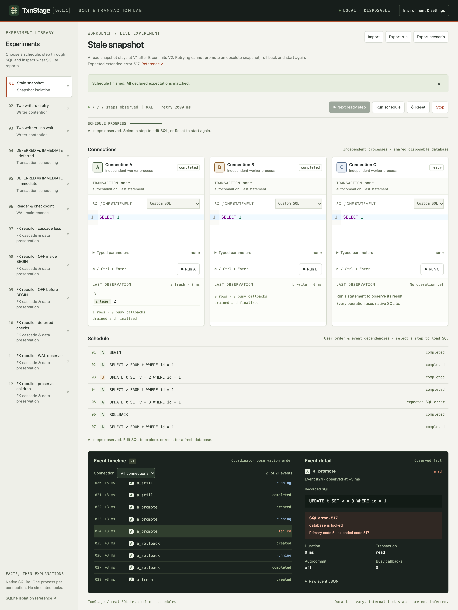

<p align="left"></p>

# TxnStage

[](Cargo.toml)
[](https://www.sqlite.org/)
[](LICENSE)
[](https://github.com/0then0/txnstage/actions/workflows/ci.yml)

A local visual laboratory for SQLite transactions, concurrency and data preservation. Run SQL across independent connections, inspect the results, and share experiments as portable JSON files.

TxnStage creates a temporary database for each experiment and runs each connection in its own process. The workbench includes experiments for read snapshots, writer contention, WAL checkpoints and cascading foreign keys during table rebuilds. The executable includes the web interface and bundled SQLite. It runs locally without accounts or external services and works only with its own disposable databases.



## Quick start

Extract an archive from [Releases](https://github.com/0then0/txnstage/releases) and start the executable, or build from source using the commands below:

```sh
./txnstage serve
```

On Windows, use `txnstage.exe serve`. Open the full loopback URL printed in the terminal. The fragment contains a random per-launch token; the UI moves it to session storage and removes it from the address bar. Ctrl+C stops workers and removes the owned experiment directory. Closing the browser tab does not stop the CLI server. Port selection is automatic; `serve --port 8080` requests a specific port.

To build from source, install Rust stable, a native C toolchain, Node.js 24 and pnpm 12.14.0, then run from the repository root:

```sh
cd frontend
pnpm install --frozen-lockfile
pnpm build
cd ..
cargo build --release --locked
./target/release/txnstage serve
```

Build the frontend before Cargo. Neither Node.js nor a system SQLite installation is needed to run the resulting release executable. macOS binaries are currently unsigned; Linux binaries depend on the build runner's libc. See [development and delivery](docs/development.md).

## An experiment: an obsolete read snapshot

Choose **Stale snapshot**. Use **Next ready step** to run one operation at a time, or **Run schedule** to execute the experiment in a fresh database. The schedule orders operations using observed events.

```sql
-- A                         -- B
BEGIN;
SELECT v FROM t WHERE id=1;   -- 1
                             -- UPDATE t SET v=2 WHERE id=1; (autocommit)
SELECT v FROM t WHERE id=1;   -- still 1
UPDATE t SET v=3 WHERE id=1;  -- SQLITE_BUSY_SNAPSHOT, extended code 517
ROLLBACK;
SELECT v FROM t WHERE id=1;   -- 2
```

These lines are separate steps. A snapshot cannot be promoted to a writer after another connection has committed intervening changes. Increasing the retry budget does not make it current. This is documented SQLite behavior, not a SQLite defect. [SQLite isolation](https://www.sqlite.org/isolation.html).

Explore the [experiment catalog](examples/README.md) to compare writers with and without retries, DEFERRED and IMMEDIATE transactions, and a reader that prevents a complete PASSIVE checkpoint. A PASSIVE result with `busy = 0` can still have `checkpointed < log`. [Checkpoint semantics](https://www.sqlite.org/c3ref/wal_checkpoint_v2.html).

Experiments **07–12 · FK rebuild** show how a table rebuild can preserve parent records while deleting their children through `ON DELETE CASCADE`. Successful COMMIT and integrity checks can accompany missing application records, and an old read snapshot can hide the loss. The [FK rebuild guide](docs/fk-rebuild-lab.md) explains the SQL, PRAGMA settings, preservation checks and Drizzle/D1 context.

## Using the workbench

- Each connection card owns a CodeMirror SQL editor, typed JSON parameters, a Run button and its last observation. Ctrl+Enter or Cmd+Enter runs that card. Tab navigates controls; focus remains visible.
- Select a schedule step to load its SQL. Edit it, run a different connection first, or choose Custom SQL. Manual operation order is recorded independently from the template's declared schedule.
- Run dispatches one statement and returns immediately. A waiting B does not prevent A from committing. **Busy observed** appears only after an actual callback event, never after a UI timer.
- **Cancel A/B/C** interrupts one active operation. **Stop** terminates the experiment's workers. **Reset** recreates workers and a fresh database with the selected schema and settings.
- **Environment & settings** exposes journal mode, busy budget, deadline, row limits, connection count and initial SQL. Settings take effect through Reset or Rerun.
- **Export scenario** saves the editable schedule. **Export run** saves the actual submitted SQL, captured event dependencies, metadata and observations. Unexecuted draft edits do not rewrite the recorded run.
- **Import** opens a scenario or recording for viewing without executing SQL. **Rerun in fresh DB** is a separate execution action. Environment differences are displayed; identical timings are never promised.
- Select a completed event to inspect its recorded SQL, typed result table and transaction state. After **Run schedule** finishes successfully, each editor offers `SELECT 1` as a starting point for custom SQL.

## Command-line use

The CLI and UI use the same coordinator, workers, SQL restrictions and scheduler:

```sh
./target/release/txnstage version
./target/release/txnstage scenarios my-scenarios
./target/release/txnstage run examples/01.scenario.json --output run.recording.json
./target/release/txnstage run run.recording.json --output rerun.recording.json
```

`run` returns a nonzero status for infrastructure errors, cancellation, deadlines or mismatched expectations. An explicitly expected SQLite error, such as 517, is retained as a SQL error event and counts as a matched scenario expectation. `version` prints SQLite version, source ID, compile options, platform and application version.

## Interpreting results and limits

The event sequence is the coordinator's observation order. It does not reveal exact lock ownership or SQLite's internal ordering. Durations and the number of retries vary. Transaction state comes from `sqlite3_txn_state` and `sqlite3_get_autocommit`, sampled after a statement is finalized. During a running operation the card shows the last sampled state.

The instrumented busy policy retries at fixed 10 ms intervals, within a configurable elapsed operation budget. It is not SQLite's built-in timeout algorithm. SQLite may return BUSY without calling a busy handler. Assigning `busy_timeout`, `wal_autocheckpoint` or `journal_mode` through SQL is rejected, so instrumentation cannot silently disappear. [SQLite busy handler documentation](https://www.sqlite.org/c3ref/busy_handler.html).

Each experiment supports 2–3 connections, up to 200 user operations, 50 initialization statements, 64 KiB SQL per operation, 100 parameters, 200 preview rows (shown in pages of 20), a 30 s deadline, and an 8 MiB imported file. Rows are fully consumed and the statement finalized before completion, including RETURNING; display limits never leave a cursor open. BLOBs have a 128-byte hex preview, TEXT a 4096-byte preview, and truncation is explicit. INTEGER uses a decimal string, preserving all signed 64 bits in JavaScript. Infinity uses an explicit REAL string. Keeping a cursor open between operations is not supported.

Extension loading and filesystem SQL are disabled; ATTACH and VACUUM INTO are rejected by SQLite's authorizer. Only whitelisted PRAGMAs are allowed. The server binds IPv4 loopback, checks exact Host/Origin and requires the per-launch token for all API routes. An explicit **Run** is allowed to change only the owned experiment. No API accepts a filesystem path. [Isolation, resources and cancellation](docs/architecture.md).

## Documentation and development

```sh
cd frontend
pnpm check
pnpm test
pnpm build
cd ..
cargo fmt --check
cargo clippy --locked --all-targets -- -D warnings
cargo test --locked
cargo build --release --locked
cd frontend
pnpm exec playwright install chromium
pnpm e2e
cd ..
```

Playwright starts the **production binary** and exercises UI → HTTP → worker processes → bundled SQLite. It does not use a Vite server or mock SQLite. CI runs the same checks on Linux, macOS and Windows. See the workflow badge for current results.

- [Architecture and observation model](docs/architecture.md)
- [Versioned artifact format](docs/artifact-format.md)
- [Development, tests and manual release workflow](docs/development.md)
- [Test coverage and verification](docs/verification.md)
- [Scenario guide and sample recordings](examples/README.md)
- [FK cascade and data preservation lab](docs/fk-rebuild-lab.md)

License: [Apache-2.0](LICENSE).
