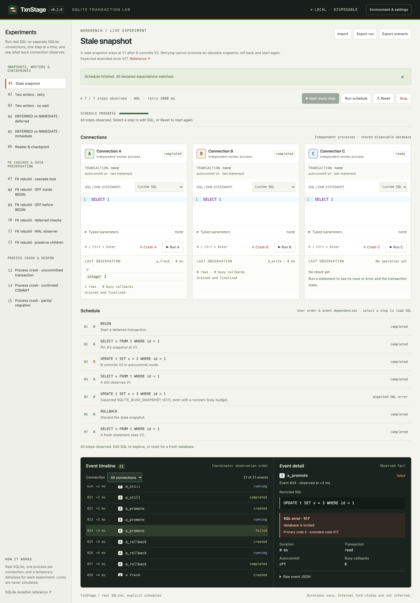

<p align="left"></p>

# TxnStage

[](Cargo.toml)
[](https://www.sqlite.org/)
[](LICENSE)
[](https://github.com/0then0/txnstage/actions/workflows/ci.yml)

A local visual laboratory for SQLite transactions, concurrency and data preservation. Run real SQL across independent connections, see what SQLite reports at each step, and share experiments as portable JSON files.

TxnStage is for questions that are hard to answer by reading documentation alone: what a second connection sees while a transaction is open, when a write returns `SQLITE_BUSY`, what a checkpoint can do while a reader is active, which rows a table rebuild keeps, and what remains in a database after a process dies.



## How it works

- Each experiment gets a fresh temporary database that TxnStage creates and deletes. It never opens your own databases.
- Each connection (A, B and optionally C) runs in its own operating-system process with its own SQLite connection, so locking and isolation are real, not simulated.
- You run one SQL statement at a time on a chosen connection. The order across connections is explicit and repeatable.
- Every statement produces events: its result rows or error code, the transaction state afterwards and the number of busy callbacks.
- One executable contains the web interface, the command-line runner and its own build of SQLite; `txnstage version` prints the exact SQLite version. It runs locally without accounts or network services.

## Quick start

Download an archive for your platform from [Releases](https://github.com/0then0/txnstage/releases), extract it and start the executable:

```sh
./txnstage serve
```

On Windows, run `txnstage.exe serve`. Open the complete URL printed in the terminal, including the part after `#`. That part is a random token for this launch; the interface stores it for the session and removes it from the address bar. Press Ctrl+C in the terminal to stop the workers and delete the experiment database. Closing the browser tab does not stop the server. A free port is chosen automatically; use `serve --port 8080` to request one.

macOS and Windows binaries are unsigned, and Linux binaries depend on the C library of the build machine. To build from source instead, install Rust stable, a C toolchain, Node.js 24 and pnpm 12.14.0, then run from the repository root:

```sh
cd frontend
pnpm install --frozen-lockfile
pnpm build
cd ..
cargo build --release --locked
./target/release/txnstage serve
```

Build the frontend before Cargo, because the executable embeds the built interface. Running the result needs neither Node.js nor an installed SQLite. [Development and distribution](docs/development.md) has the details.

## A first experiment

Choose **Stale snapshot** in the experiment list. Press **Next ready step** to run one statement at a time, or **Run schedule** to run the whole experiment in a fresh database.

```sql
-- A                         -- B
BEGIN;
SELECT v FROM t WHERE id=1;   -- 1
                             -- UPDATE t SET v=2 WHERE id=1; (autocommit)
SELECT v FROM t WHERE id=1;   -- still 1
UPDATE t SET v=3 WHERE id=1;  -- SQLITE_BUSY_SNAPSHOT, extended code 517
ROLLBACK;
SELECT v FROM t WHERE id=1;   -- 2
```

Each line is a separate step. A reads inside a transaction and keeps seeing the value from when it started, even after B commits a change. When A then tries to write, SQLite refuses with error 517: a read snapshot cannot become a writer once another connection has committed newer changes. Waiting longer does not help; A has to roll back and start again. This is documented SQLite behavior, described in [Isolation in SQLite](https://www.sqlite.org/isolation.html).

## Terms used in the interface

- **Experiment**: one temporary database with its worker processes. Reset starts a new one.
- **Connection**: one worker process holding one SQLite connection, named A, B or C.
- **Step** or **operation**: one SQL statement on one connection, or a crash or reopen of that connection's process.
- **Schedule**: the ordered steps of an experiment. A step can wait for an event of an earlier step, for example "run after B's write has reported busy".
- **Event**: something TxnStage observed, in the order it was observed: a step was created, started running, reported a busy callback, or ended as completed, failed, cancelled or timed out.
- **Scenario**: a JSON file describing an experiment: starting schema, settings, steps and expected results.
- **Recording**: a JSON file with a scenario as it was actually run, the SQLite environment and all observed events.

## Experiment catalog

Fifteen experiments are built in and are also available as files in [examples](examples/README.md):

- **01–06 · Snapshots, writers and checkpoints**: a stale read snapshot, two writers with and without retrying, DEFERRED compared with IMMEDIATE transactions, and a reader that keeps a PASSIVE checkpoint from finishing. A PASSIVE checkpoint can report `busy = 0` and still leave frames behind; see [checkpoint modes](https://www.sqlite.org/c3ref/wal_checkpoint_v2.html).
- **07–12 · FK rebuild**: rebuilding a parent table can keep the parents and delete their children through `ON DELETE CASCADE`, while COMMIT and both integrity checks succeed. The [FK rebuild guide](docs/fk-rebuild-lab.md) explains the SQL, PRAGMA settings, preservation checks and the Drizzle/D1 context.
- **13–15 · Process crash**: one connection's process is terminated and the same database is reopened. An uncommitted transaction is gone, a confirmed COMMIT remains, and a partially applied synthetic migration needs a resumable rerun. These model the abrupt end of a single process, not power loss or storage faults. See the [catalog](examples/README.md#process-crash-and-reopen).

Experiments 13–15 and the Crash and Reopen actions require release 0.3.0 or later. The [changelog](CHANGELOG.md) lists what each release contains.

## Using the workbench

- **Connection cards.** Each card has a SQL editor, optional typed parameters, a Run button and the last result. Ctrl+Enter or Cmd+Enter runs the statement in that card. All controls are reachable with Tab.
- **Schedule.** Select a step to load its SQL into the matching card. You can edit it, run another connection first, or choose Custom SQL. Your actual order is recorded separately from the experiment's declared schedule.
- **Running.** Run sends one statement and returns immediately, so a waiting B does not stop you from committing on A. **Busy observed** appears only when SQLite actually called the busy handler, never because time passed.
- **Crash and Reopen.** **Crash A/B/C** forcibly terminates that connection's worker process between statements. The card then shows the connection as closed and its transaction state as lost. **Reopen** starts a new worker on the same database file without rerunning the initial SQL. Both are recorded as steps and repeat on replay.
- **Cancel, Stop, Reset.** **Cancel A/B/C** interrupts one running statement. **Stop** terminates all workers of the experiment. **Reset** creates new workers and a fresh database with the selected schema and settings.
- **Environment & settings.** Journal mode, busy retry budget, deadline, displayed rows, number of connections and initial SQL. Changes apply on Reset or on the next run.
- **Export.** **Export scenario** saves the editable schedule. **Export run** saves a recording: the SQL that was actually submitted, the observed order, environment details and all events. Edits you have not run do not change the recording.
- **Import.** Opens a scenario or recording for viewing without running any SQL. **Rerun in fresh DB** is a separate, explicit action. Differences between the recorded and the current environment are listed.
- **Event detail.** Select an event in the timeline to see its SQL, typed result table, error codes and transaction state.

## Command-line use

The command line runs the same engine as the interface, with the same SQL restrictions:

```sh
./target/release/txnstage version
./target/release/txnstage scenarios my-scenarios
./target/release/txnstage run examples/01.scenario.json --output run.recording.json
./target/release/txnstage run run.recording.json --output rerun.recording.json
```

- `version` prints the SQLite version, source ID, compile options, platform and application version.
- `scenarios <directory>` writes the built-in experiments as scenario files.
- `run <file>` executes a scenario or reruns a recording in a fresh database and writes a new recording.

`run` exits with 0 when every expectation in the scenario matched. An SQLite error that the scenario expects, such as 517 above, counts as a match and is still recorded as an error event. Infrastructure failures, cancellation, deadlines and mismatched expectations give a nonzero exit code.

## Reading the results

- The event order is the order in which TxnStage observed events. It does not reveal which connection holds which lock or SQLite's internal ordering.
- Durations and the number of busy callbacks vary between runs. Compare results and error codes, not timings.
- Transaction state comes from `sqlite3_txn_state` and `sqlite3_get_autocommit`, read after each statement finishes. While a statement runs, the card shows the previous reading.
- Busy handling is TxnStage's own: it retries every 10 ms until the configured budget is used up, and counts every callback. It is not SQLite's built-in `busy_timeout`, and SQLite can return BUSY without calling any handler. See [busy handlers](https://www.sqlite.org/c3ref/busy_handler.html).
- INTEGER values are shown and stored as decimal strings, so all 64 bits survive in JavaScript. BLOBs are shown as hex. Infinite REAL values use an explicit string.
- A statement is always run to completion and finalized, including `RETURNING`. Row limits affect only what is displayed and are marked when applied.

## Limits and safety

- 2–3 connections, up to 200 steps, 50 initialization statements, 64 KiB of SQL per step and 100 parameters.
- Up to 200 result rows are kept per statement, shown in pages of 20. BLOB previews are 128 bytes and TEXT previews 4096 bytes.
- A statement can run for at most 30 seconds. Imported files can be at most 8 MiB.
- One statement per step. Keeping a cursor open between steps is not supported.
- Extension loading, file access from SQL, `ATTACH` and `VACUUM INTO` are rejected. Only a fixed list of PRAGMAs is allowed. Setting `busy_timeout`, `wal_autocheckpoint` or `journal_mode` through SQL is rejected so that instrumentation stays in place; change them in the experiment settings.
- The server listens only on the IPv4 loopback address, checks the Host and Origin headers and requires the launch token for every API request. No API accepts a file path.

These restrictions are an application-level sandbox around the bundled SQLite, not an operating-system security boundary. [Architecture](docs/architecture.md#resources-and-local-isolation) and the [security policy](SECURITY.md) describe the model.

## Documentation

- [Experiment catalog and sample recordings](examples/README.md): what each built-in experiment shows and how to run it.
- [FK rebuild guide](docs/fk-rebuild-lab.md): cascading deletes during a table rebuild and how to check that data was preserved.
- [Artifact format](docs/artifact-format.md): the scenario and recording JSON files.
- [Architecture](docs/architecture.md): processes, statement lifecycle, cancellation, crash and reopen, limits and what observations mean.
- [Development and distribution](docs/development.md): building, running checks, updating examples and packaging.
- [Testing and verification](docs/verification.md): what the automated checks cover and how to read their reports.
- [Changelog](CHANGELOG.md): changes by release.

## Contributing and project policies

Contributions are welcome. [Contributing](CONTRIBUTING.md) covers setup, checks and pull requests. The [Code of Conduct](CODE_OF_CONDUCT.md) applies to all project spaces. Report vulnerabilities privately as described in the [security policy](SECURITY.md).

## License

TxnStage is licensed under [Apache-2.0](LICENSE).
